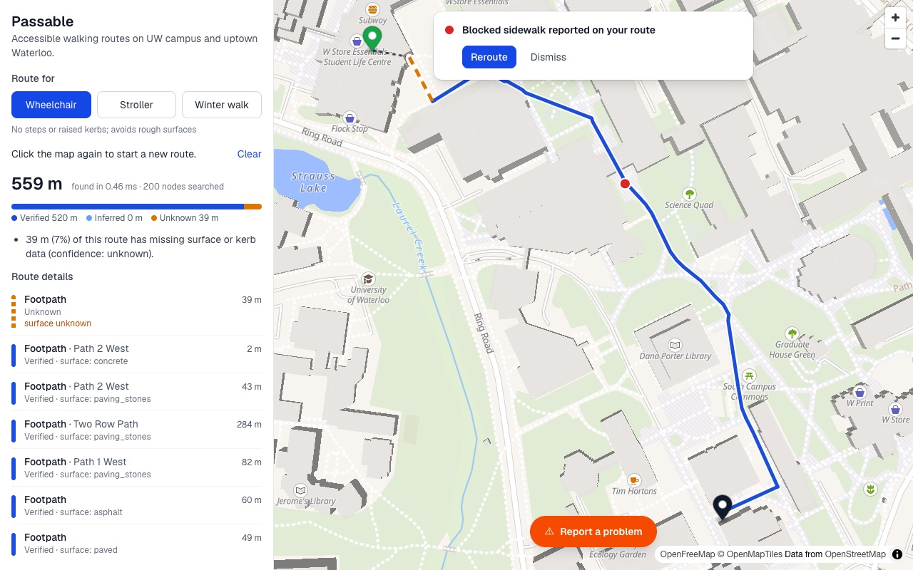
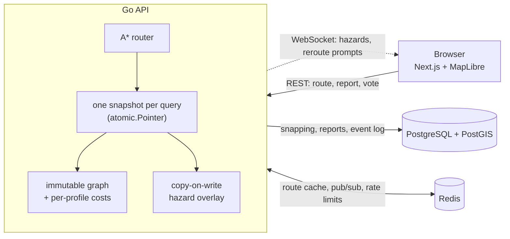

# Passable

**Accessible walking routes for the University of Waterloo campus and uptown Waterloo, kept up to date by the people using them.**

Passable plans routes for three profiles:
- **wheelchair** never uses steps, raised kerbs or rough surfaces;
- **stroller** never uses steps and avoids rough ground;
- **winter walk** avoids steps and unpaved paths, and reacts most strongly to ice.

Every route says how much it trusts the map data (verified, inferred or unknown). Anyone can report a hazard, such as an elevator that's out, a blocked sidewalk, construction or ice. Reports change everyone's routes within seconds. Only the people whose route is affected get a "reroute?" prompt. Reports are confirmed or resolved by votes and expire on their own.

**Live:** https://passable-alpha.vercel.app · [status](https://passable-alpha.vercel.app/status) · [about & limitations](https://passable-alpha.vercel.app/about) · API: https://passable-api.fly.dev



## Run it locally (about 10 minutes)

You need **Docker**, **Go 1.27+**, **Node 20.9+**, plus `curl` and `jq`.

```sh
git clone https://github.com/PrateekGithub23/passable && cd passable
docker compose up -d --wait      # Postgres+PostGIS on :5433, Redis on :6379
go run ./cmd/migrate             # create the schema
scripts/fetch_osm.sh             # download campus paths from OpenStreetMap (~1 min)
go run ./cmd/importer            # build the routing graph: 21,173 path segments
go run ./cmd/api                 # API on http://localhost:8080 (leave running)
```
In a second terminal:
```sh
cd web && npm install && npm run dev    # http://localhost:3000
```

Then, on the map:
1. **Get a route:** click a start point, then a destination, and switch profiles to compare. Line colours show confidence: dark blue is verified, light blue inferred, dashed amber unknown.
2. **Report a problem:** press **Report a problem**, tap the spot, choose what it is, and send.
3. **See live updates:** open a second browser window with a route over that spot. It gets the reroute prompt.
4. **Without real reports:** `go run ./cmd/simulator` files clearly labelled demo hazards and cleans up when you press Ctrl-C.

If OpenStreetMap's Overpass API rate-limits the download, wait a minute, or run `OVERPASS=https://overpass.kumi.systems/api/interpreter scripts/fetch_osm.sh`.

## How it works



1. **Import.** OpenStreetMap paths are split into a graph at every junction, keeping the accessibility tags: surface, steps, kerbs, crossings.
2. **Cost model.** Each profile turns those tags into a cost: `length × multiplier + penalty`, or *blocked*. Missing data is penalized and labelled, never silently assumed fine.
3. **Routing.** A* with a straight-line-distance heuristic runs over the whole graph in memory, so a search takes about 0.5 ms. Routes start and end partway along a path, at the point nearest where you clicked.
4. **Hazards without locks** (the core engineering problem). Reports change edge costs while searches are running. The graph never changes. Live hazards sit in a small **immutable snapshot** behind an atomic pointer. Each query reads the pointer once, so it sees one consistent state. A new report builds a new snapshot and swaps it in, so searches never wait. Every change gets a global sequence number from the Postgres event log. That number is the graph version, and it's part of the route cache key, so stale routes are never served.
5. **Live updates.** Changes travel between API instances over Redis pub/sub. An index from each path segment to the users routing over it means only affected users are prompted. If a message is lost, the instance reloads from Postgres, the source of truth.

More detail: [architecture and request flows](docs/ARCHITECTURE.md) · [every design decision and what was rejected](DECISIONS.md) · [API reference](docs/API.md).

## Results

All numbers come from real runs; details in [`docs/benchmarks/`](docs/benchmarks).

| What | Result | Source |
|---|---|---|
| One route search (A*, wheelchair, 2000 random campus queries) | p50 **0.50 ms**, p99 **2.7 ms**, ~2,100 nodes expanded | `cmd/bench`, Day 8 |
| HTTP load, 1,000 route requests/s with hazards changing every second | **0 failures** in 30k requests, p95 **5.6 ms**, p99 12.3 ms | k6, [day8.md](docs/benchmarks/day8.md) |
| Route cache (stable graph version) | 40% hit rate; hit p95 **1.0 ms** against 5.0 ms for a miss | k6, day 8 |
| Report → WebSocket client, across two API instances | p50 **6.3 ms**, p95 8.4 ms, including the database write | `cmd/wsprobe`, [day6](docs/benchmarks/day6-propagation.md) |
| Concurrency: routes vs. hazard writes | **27,055 routes** during **141,586 snapshot swaps**, all consistent, race detector clean | overlay stress test |
| **Production:** route not in the cache, server time | **11.6 ms** average (mostly the two database queries between Fly and Neon) | `/metrics` on Fly |
| **Production:** report in one browser → prompt in another | **470 ms** end to end, both over the internet | two-browser test on the live site |

## Data coverage and limitations

OpenStreetMap data for the bbox `43.455,-80.565,43.485,-80.505`, fetched 2026-10-24.

| Data | Coverage |
|---|---|
| Graph | 15,468 nodes, 21,173 edges, 703 km of paths and streets |
| Surface tagged (footways and paths) | **70%** of edges; the rest are labelled `inferred` (sidewalks, roads) or `unknown` |
| Steps / crossings / kerbs | 237 steps edges, 2,167 crossing edges (1,177 with kerb data), 1,277 kerb nodes |
| Smoothness / incline / `wheelchair` tags | 1.3% / 0.1% / 0.1% of footway, path and pedestrian edges |

What that means:
- **No slope data.** Elevation is out of scope and `incline` is almost never tagged, so a steep path can be suggested to a wheelchair user.
- **Indoor routes are mostly missing.** Only 8 elevators are mapped, and indoor corridors are usually disconnected from outdoor paths.
- **Crossings are detected only where they're mapped as their own path.**
- **Reports are unverified until confirmed by other people.**

Full numbers are in [Data coverage details](#data-coverage-details) below.

## Testing

```sh
go test -race ./...                              # unit, property and golden tests; no Docker needed
go test -tags integration -race ./integration     # real PostGIS + Redis via testcontainers, 2 API instances
cd web && npm run lint && npm run typecheck       # frontend
k6 run -e RATE=200 scripts/k6/load.js            # load test (API started with -rate-limit=false)
```
- **Property tests:** A* returns exactly Dijkstra's cost on random graphs and on 450 real campus queries. The cost model never drops below edge length, which keeps A* exact.
- **Golden routes:** 3 campus trips × 3 profiles, pinned to recorded results, using a committed snapshot of the real graph (`testdata/`).
- **Concurrency:** a race-detector stress test of routing during constant hazard writes; the hub's targeting; the rate limiter's atomicity.
- **Integration:** the full hazard lifecycle across two API instances on real Postgres and Redis (WebSocket delivery, cache key change, votes, expiry, gap → resync), plus a regression test for a snapping bug the load test found.
- **CI** runs all of it on every push, and a push to `main` that passes deploys the API to Fly.io. The site deploys from the same push through Vercel ([how deployment works](docs/DEPLOY.md#how-continuous-deployment-works)).

## Repository map

| Path | What's there |
|---|---|
| `cmd/api` | The HTTP + WebSocket server |
| `cmd/importer`, `scripts/fetch_osm.sh`, `scripts/gate.sh` | OpenStreetMap download, coverage check, graph import |
| `cmd/migrate`, `db/migrations` | Schema migrations (goose, embedded in the binary) |
| `cmd/route`, `cmd/bench`, `cmd/wsprobe`, `cmd/simulator`, `cmd/exportgraph` | CLI routing, benchmarks, propagation probe, demo simulator, test-fixture export |
| `internal/graph`, `internal/cost`, `internal/route` | Graph, per-profile cost model, A* |
| `internal/hazard`, `internal/overlay`, `internal/reports` | Hazard rules, copy-on-write overlay, persistence and lifecycle |
| `internal/live`, `internal/cache`, `internal/ratelimit`, `internal/metrics` | WebSocket hub + Redis bus, route cache, rate limiting, Prometheus |
| `internal/api` | Handlers, snapping, explanations, CORS, stats |
| `web/` | Next.js frontend (`/`, `/about`, `/status`) |
| `integration/`, `testdata/`, `scripts/k6/` | Integration tests, graph fixture, load test |
| `docs/` | Architecture, API, deployment, benchmarks, demo script |

## Data coverage details

**OSM tag counts** (`scripts/gate.sh`; "ped ways" = `highway` footway/path/pedestrian)

| Metric | Count |
|---|---|
| Ped ways | 5,239 |
| … with `surface` | 3,475 (66.3%) |
| … with `smoothness` / `incline` / `wheelchair` | 73 (1.4%) / 11 (0.2%) / 6 (0.1%) |
| `footway=sidewalk` ways / `footway=crossing` ways | 1,658 / 1,074 |
| `highway=crossing` nodes / `highway=steps` ways | 1,684 / 246 |
| Nodes with `kerb` / elevator nodes | 1,277 / 8 |

**Imported graph** (`cmd/importer` + verification SQL)

| Metric | Value |
|---|---|
| Ways → edges | 9,013 → 21,173 (36 degenerate stretches skipped) |
| Total length | 703.1 km (footway 313.1 km, service 153.8, residential 95.4) |
| Footway/path/pedestrian edges | 11,159; surface on 70.3% of edges, 68.7% of length |
| Edges with kerb info | 2,459 (`lowered` 2,251, `flush` 179, `raised` 19) |
| Nearest-edge check (Dana Porter Library) | 5 nearest edges at 14.5–19.0 m |

---
Map data © OpenStreetMap contributors (ODbL). Basemap by OpenFreeMap. Built as a 10-day solo project.
