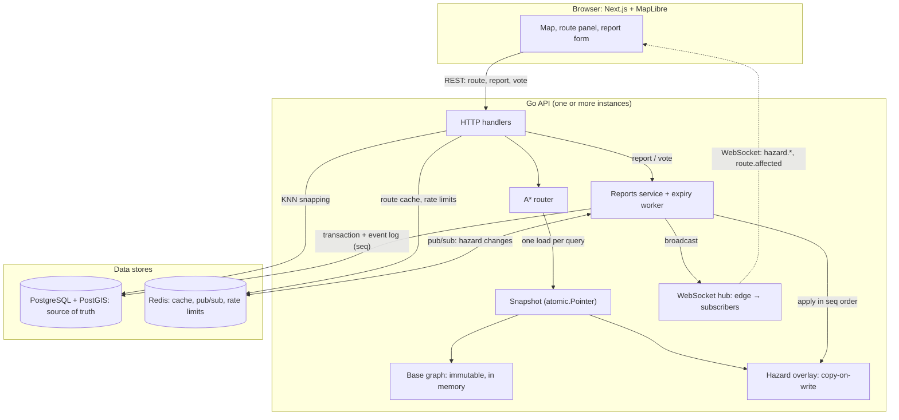
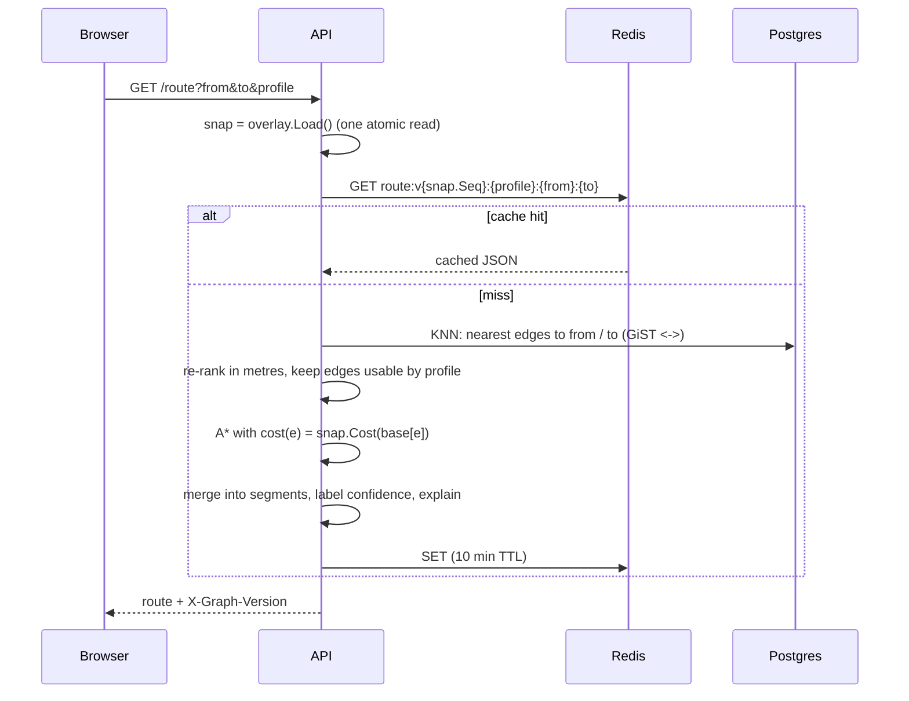
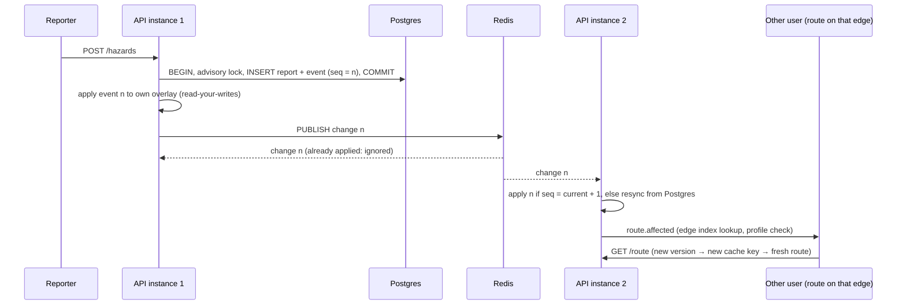

# Architecture

## Components

| Component | Code | Role |
|---|---|---|
| Importer | `cmd/importer` | Splits OSM ways into graph edges at junctions and loads Postgres (one transaction) |
| Base graph | `internal/graph` | Immutable nodes and undirected edges with CSR adjacency, loaded once at startup (~9 MiB) |
| Cost model | `internal/cost` | Per-profile edge costs from OSM tags: `length × multiplier + penalty`, or blocked |
| Router | `internal/route` | A* with a haversine heuristic; starts and ends partway along edges |
| Hazard rules | `internal/hazard` | Pure functions: effects per profile, TTLs, lifecycle state machine |
| Overlay | `internal/overlay` | Immutable snapshots of live hazards behind `atomic.Pointer` |
| Reports | `internal/reports` | Postgres writes under a global advisory lock, event log, expiry worker, resync |
| Live | `internal/live` | WebSocket hub (viewport + route subscriptions) and the Redis pub/sub bus |
| API | `internal/api` | HTTP handlers, snapping, segment explanations, CORS, rate limits, stats |

## Flow 1: a route request

The whole request uses **one** overlay snapshot. If a hazard lands mid-request, this request keeps its consistent view, and the next one sees the new version under a new cache key.

## Flow 2: a hazard report reaching other users

## Guarantees and how they're kept

| Guarantee | Mechanism | Tested by |
|---|---|---|
| A query never sees half-applied hazard changes | Immutable snapshots, one `atomic.Pointer` load per query | `TestConcurrentRoutingSeesConsistentSnapshots` (race detector, 27k routes against 141k swaps) |
| Searches never wait for writers | Writers copy small maps and swap the pointer; readers take no locks | same |
| Every instance agrees on what version N means | `pg_advisory_xact_lock` serializes hazard writes, so seq order equals commit order | `TestHazardLifecycleAcrossInstances` |
| Stale routes are never served | The cache key contains the graph version | `TestPlanSeesHazards`, integration test |
| Lost pub/sub messages don't leave an instance wrong | A gap causes a resync from Postgres; a periodic catch-up (`EXPIRY_INTERVAL`: 30 s by default, 10 min on Fly) handles a lost last message | `TestGapTriggersResync`; manual Redis-pause test (DECISIONS #24) |
| Only affected users are prompted | Inverted index edge → clients, plus a per-profile effect check | `TestHubRoutingOfMessages` |
| A* returns optimal routes | Every cost ≥ edge length, and the haversine heuristic is admissible | `TestCostNeverBelowLength`, `TestAStarMatchesDijkstra*` |

The reasoning behind each choice, and what was rejected, is in [`DECISIONS.md`](../DECISIONS.md).
